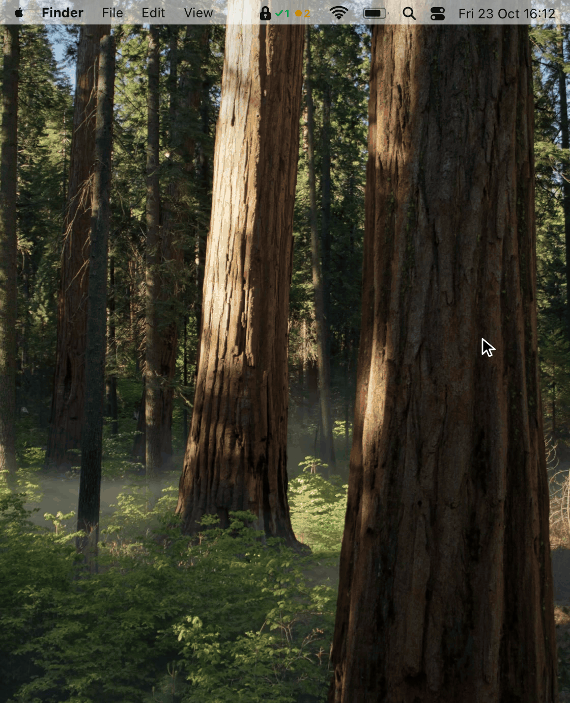

<p align="center">
  
</p>

<h1 align="center">pimbar</h1>

<p align="center">
  <strong>Azure PIM in your macOS menu bar.</strong><br>
  Elevate into your Azure roles, approve your team's requests and see what's
  active, without opening the Azure portal.
</p>

<p align="center">
  <a href="#install">Install</a> · <a href="#first-launch">First launch</a> ·
  <a href="#using-pimbar">Using pimbar</a> · <a href="#privacy">Privacy</a>
</p>

## Features

- **Elevate in a few clicks**: pick a role, how long you need it and why.
  Roles that need an approver say **Request**, and you can cancel it while it
  waits.
- **Approve or deny** requests waiting for you, with the requester's reason
  right there.
- **See what's active** and how long it has left, at a glance in the menu bar,
  and stop a role when you're done.
- **Get notified** about new requests, decisions on yours, and roles about to
  expire.
- **Hide what you never use**: click a subscription or role with two fingers.
- **History** of your activations, stops and reviews.

pimbar works with **Azure resource roles**: subscriptions, resource groups and
resources. Entra ID roles and PIM for Groups aren't supported yet.

## Demo

<p align="center">
  <picture>
    <source media="(prefers-color-scheme: dark)" srcset="docs/demo-dark.gif">
    
  </picture>
</p>

## Install

> [!IMPORTANT]
> **pimbar isn't signed by Apple yet**, so macOS blocks it the first time you
> open it. That's expected: **don't click Move to Bin**. Follow
> [First launch](#first-launch) below; it takes a minute.

**You need**

- a Mac with Apple silicon, on macOS 13 or later;
- the [Azure CLI](https://learn.microsoft.com/cli/azure/install-azure-cli-macos),
  signed in:

  ```sh
  brew install azure-cli
  az login
  ```

**Install with [Homebrew](https://brew.sh)**

```sh
brew tap blturan/pimbar https://github.com/blturan/pimbar
brew trust --cask blturan/pimbar/pimbar
brew install --cask pimbar
```

Homebrew only loads casks from taps outside its own once you trust them, which
is what `brew trust` does.

**Or by hand:** download the `.dmg` from
[Releases](https://github.com/blturan/pimbar/releases), open it and drag pimbar
to Applications.

### First launch

pimbar is free and open source, but not signed by Apple, which needs a paid
Apple developer account. So the first time you open it, macOS says *“Apple
could not verify ‘pimbar’ is free of malware…”*. To open it anyway:

1. Click **Done**, not **Move to Bin**.
2. Open **System Settings → Privacy & Security** and scroll down to
   **Security**.
3. Next to *“‘pimbar’ was blocked to protect your Mac”*, click
   **Open Anyway**. Click **Open Anyway** again and confirm with your password
   or Touch ID.

pimbar starts and shows a lock in the menu bar. If you installed the `.dmg`,
updates from pimbar's Settings don't ask again; with Homebrew, macOS may ask
again after an update.

Prefer Terminal? This does the same in one step:

```sh
xattr -dr com.apple.quarantine /Applications/pimbar.app
```

## Using pimbar

Click the lock in the menu bar to open pimbar. The marks beside it tell you
what's going on without opening it:

| Mark | Means |
|---|---|
| Green check | Roles you have active |
| Amber dot | Requests waiting for your approval, or yours waiting for an approver |
| Blue spinner | Something in progress |
| Red exclamation mark | Something went wrong: open pimbar to see what |

In **Settings** you can have pimbar open at login, pick light or dark, choose
how often it checks for changes, and test notifications. When a new version is
out, **Settings → Updates** installs it. To use another Azure account, run
`az login` again.

## Privacy

pimbar signs in with your Azure CLI account, so there's nothing to set up in
Entra ID, and it can do exactly what you can in the portal, nothing more. It
only talks to Azure, and to GitHub to check for updates. Your settings and
history stay on your Mac.

## Contributing

Bug reports and pull requests are welcome. See [CONTRIBUTING.md](CONTRIBUTING.md)
to build pimbar and find your way around the code.

## License

Copyright 2026 [blturan](https://github.com/blturan). Licensed under the [Apache License 2.0](LICENSE).
pimbar is not affiliated with Microsoft; Azure and Entra are trademarks of
Microsoft.
